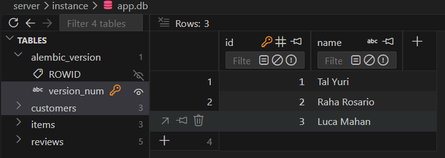
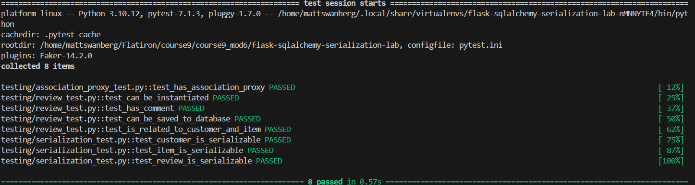

# Flask-SQLAlchemy Serialization Lab

## Project Overview

This project demonstrates how to create relational database models using Flask-SQLAlchemy and serialize those models using Marshmallow.

The application models a simple e-commerce system consisting of customers, items, and reviews. It uses SQLAlchemy relationships to connect records, an association proxy to access related items, and Marshmallow schemas to convert model instances into dictionaries.

The project also demonstrates how to prevent circular references when serializing nested relationships.

## Learning Objectives

- Create database models using Flask-SQLAlchemy.
- Establish one-to-many and many-to-one relationships.
- Configure bidirectional relationships using `back_populates`.
- Implement an association proxy to access related objects.
- Define Marshmallow schemas for model serialization.
- Serialize nested relationships while preventing recursion.
- Manage database migrations using Flask-Migrate and Alembic.
- Verify functionality using pytest.

## Technologies Used

- Python
- Flask
- Flask-SQLAlchemy
- SQLAlchemy
- Marshmallow
- Flask-Migrate
- Alembic
- SQLite
- Pytest

## Project Structure

The primary application files are located in the `server` directory.

```text
server/
├── app.py
├── models.py
├── seed.py
├── instance/
│   └── app.db
├── migrations/
│   └── versions/
└── testing/
    ├── conftest.py
    ├── review_test.py
    ├── association_proxy_test.py
    └── serialization_test.py
```

**Note:** The SQLite database is generated locally and may be excluded from version control.

## Database Models

The application contains three SQLAlchemy models.

### Customer

The `Customer` model represents a customer who can write reviews for items.

**Attributes:**
- `id`: Unique customer identifier.
- `name`: Customer's name.
- `reviews`: One-to-many relationship with `Review`.
- `items`: Association proxy providing access to reviewed items.

### Item

The `Item` model represents an item available in the database.

**Attributes:**
- `id`: Unique item identifier.
- `name`: Item name.
- `price`: Item price.
- `reviews`: One-to-many relationship with `Review`.

### Review

The `Review` model connects customers and items while storing review information.

**Attributes:**
- `id`: Unique review identifier.
- `comment`: Review text.
- `customer_id`: Foreign key referencing `customers.id`.
- `item_id`: Foreign key referencing `items.id`.
- `customer`: Relationship with the associated customer.
- `item`: Relationship with the associated item.

## Database Relationships

The application uses bidirectional SQLAlchemy relationships configured with `back_populates`.

### Customer and Review

A customer can have multiple reviews, but each review belongs to one customer.

```python
# Customer model
reviews = db.relationship('Review', back_populates="customer")

# Review model
customer = db.relationship('Customer', back_populates='reviews')
```

### Item and Review

An item can have multiple reviews, but each review belongs to one item.

```python
# Item model
reviews = db.relationship('Review', back_populates="item")

# Review model
item = db.relationship('Item', back_populates='reviews')
```

Together, these relationships allow customers and items to be associated through the `Review` model.

## Association Proxy

The `Customer` model uses SQLAlchemy's `association_proxy` to access reviewed items directly through the reviews relationship.

```python
items = association_proxy("reviews", "item")
```

Without an association proxy, accessing a customer's reviewed items requires navigating through their reviews.

The association proxy simplifies this process:

```python
customer.items
```

This returns the items associated with the customer's reviews.

## Marshmallow Serialization

Marshmallow schemas convert SQLAlchemy model instances into Python dictionaries.

The application defines three schemas:

- `CustomerSchema`
- `ItemSchema`
- `ReviewSchema`

### CustomerSchema

Serializes customer information, including associated reviews and reviewed items.

```python
customer_dict = CustomerSchema().dump(customer)
```

### ItemSchema

Serializes item information, including associated reviews.

```python
item_dict = ItemSchema().dump(item)
```

### ReviewSchema

Serializes review information, including nested customer and item details.

```python
review_dict = ReviewSchema().dump(review)
```

### Preventing Recursive Serialization

Because the models contain bidirectional relationships, nested serialization can create circular references.

For example:

```text
Customer → Review → Customer → Review → ...
```

Marshmallow's `exclude` argument prevents this behavior by omitting selected nested fields.

Example:

```python
reviews = fields.Nested(
    'ReviewSchema',
    many=True,
    exclude=("customer", "item")
)
```

This allows the application to serialize related records without repeatedly traversing the same relationships.

## Installation and Setup

### 1. Clone the Repository

```bash
git clone <repository-url>
cd <repository-directory>
```

### 2. Install Dependencies

If using Pipenv:

```bash
pipenv install
pipenv shell
```

### 3. Navigate to the Server Directory

```bash
cd server
```

### 4. Apply Database Migrations

```bash
flask db upgrade head
```

This applies the existing migrations to create the database tables.

### 5. Seed the Database

```bash
python seed.py
```

The seed script populates the database with sample customers, items, and reviews.

## Running Tests

The project includes automated tests using pytest.

Run the entire test suite from the `server` directory:

```bash
pytest -v
```

### Individual Test Files

**Review model tests:**

```bash
pytest testing/review_test.py -v
```

**Association proxy tests:**

```bash
pytest testing/association_proxy_test.py -v
```

**Serialization tests:**

```bash
pytest testing/serialization_test.py -v
```

### Test Results

All tests passed successfully.

The test suite verifies:

- Review model instantiation and attributes.
- Saving reviews to the database.
- Customer and item relationships.
- Customer association proxy functionality.
- Customer serialization.
- Item serialization.
- Review serialization.
- Nested relationship exclusions.

**Note:** The provided test fixture creates and drops database tables during testing. Depending on the database configuration, it may be necessary to restore and reseed the development database after running the tests.

## Screenshots

### Database Tables

The SQLite database contains the `customers`, `items`, and `reviews` tables.



### Successful Test Suite

The complete pytest suite passes successfully.



## Key Takeaways

This lab reinforced several important concepts in relational database development:

1. **SQLAlchemy Relationships:** Using `back_populates` allows related models to reference each other.
2. **Association Proxies:** Providing direct access to related objects simplifies navigation through association models.
3. **Marshmallow Serialization:** Schemas define how model objects are converted into dictionaries.
4. **Nested Serialization:** Related objects can be included in serialized output without manually constructing dictionaries.
5. **Recursion Prevention:** Excluding nested relationship fields prevents circular references.
6. **Database Migrations:** Alembic tracks and applies database schema changes.
7. **Automated Testing:** Pytest verifies that database relationships and serialization behave as expected.

## Author

Created by Matthew Swanberg as part of Course 9 Module 6 (Lab: Serialization)